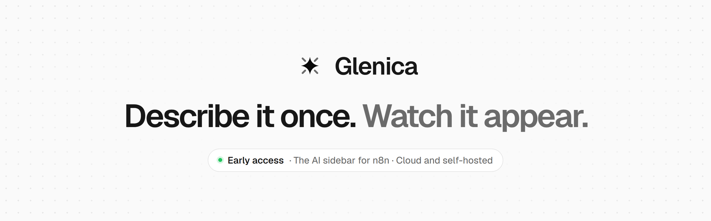
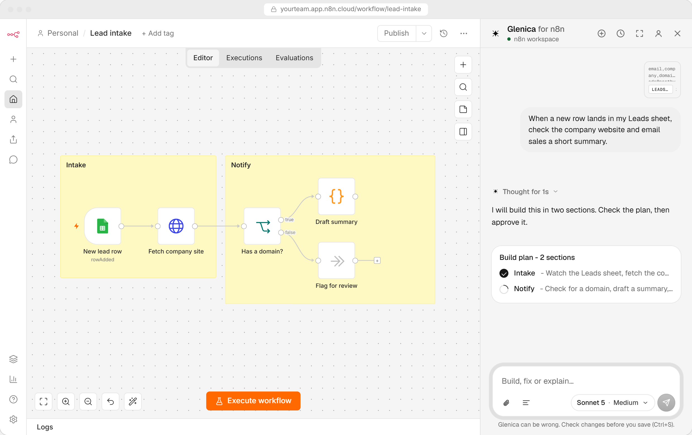
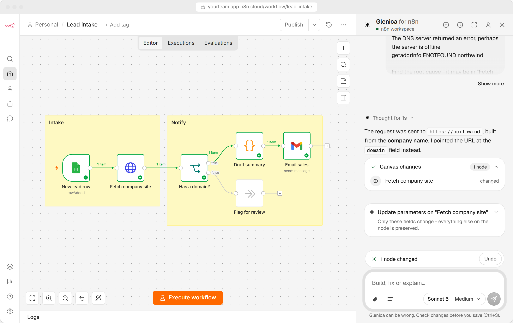
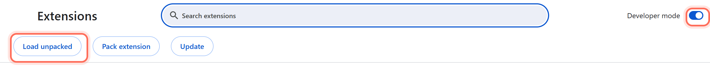
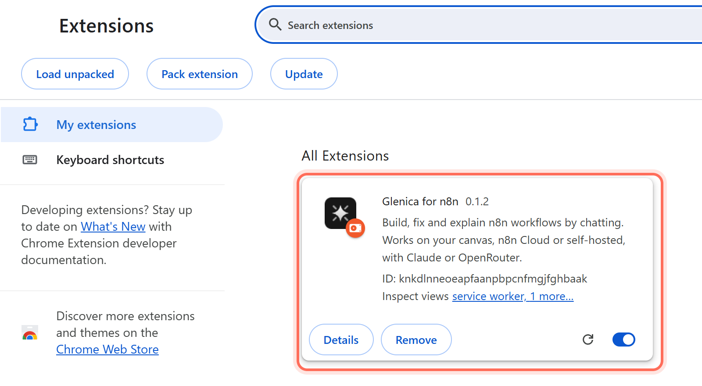

<p align="center">
  <a href="https://www.glenica.com">
    <picture>
      <source media="(prefers-color-scheme: dark)" srcset=".github/assets/banner-dark.png">
      
    </picture>
  </a>
</p>

<p align="center">
  <a href="https://github.com/glenica/glenica/releases/latest"></a>
  
  
  
</p>

<p align="center">
  <a href="https://www.glenica.com"><b>Website</b></a> ·
  <a href="https://www.glenica.com/install">Install guide</a> ·
  <a href="https://www.glenica.com/pricing">Pricing</a> ·
  <a href="https://www.glenica.com/security">Security</a> ·
  <a href="mailto:support@glenica.com">Support</a>
</p>

<br>

**Glenica for n8n** is an AI sidebar inside n8n. Ask in plain words and the nodes land on your own canvas: it plans the workflow, builds it section by section, and fixes it when a run fails.

This repository hosts the **early-access build** of the Glenica browser extension while the Chrome Web Store listing is in review. It holds release files only, not source code.

<p align="center">
  <picture>
    <source media="(prefers-color-scheme: dark)" srcset=".github/assets/build-plan-dark.png">
    
  </picture>
</p>

## What Glenica does

| | |
|---|---|
| **Build** | Describe a workflow. Glenica shows a plan, then places real nodes on your canvas, grouped into labelled sections. |
| **Fix** | When a run fails, Glenica reads the error, shows the exact change before applying it, and runs the workflow again. |
| **Explain** | Ask about any node or expression and get an answer about *your* workflow, not a generic one. |
| **Undo** | Every change Glenica makes can be undone in one click, node by node or all at once. |

<p align="center">
  <picture>
    <source media="(prefers-color-scheme: dark)" srcset=".github/assets/fix-dark.png">
    
  </picture>
</p>

## Before you start

| You need | Notes |
|---|---|
| A Chromium browser | Chrome, Edge, Brave and other Chromium browsers. Not Firefox or Safari yet. |
| n8n | n8n Cloud works straight away. Self-hosted and localhost work too (see [FAQ](#faq)). |
| An AI provider | A Claude Pro or Max plan, or an OpenRouter account. |
| A Glenica account | Created during setup. 14-day free trial, then $10 a month. See [pricing](https://www.glenica.com/pricing). |

## Install

Installation takes about three minutes.

### 1. Download the extension

Download **[`glenica-extension.zip`](https://github.com/glenica/glenica/releases/latest/download/glenica-extension.zip)** from the [latest release](https://github.com/glenica/glenica/releases/latest).

### 2. Unzip it somewhere permanent

Unzip it to a folder you will keep, for example `Documents/Glenica`. You get a folder called `glenica`.

> [!IMPORTANT]
> Your browser loads Glenica from this folder every time it starts. Do not delete or move it, or the extension stops working.

### 3. Turn on Developer mode

Open `chrome://extensions` (in Edge: `edge://extensions`, in Brave: `brave://extensions`) and switch on **Developer mode**.



### 4. Load the extension

Click **Load unpacked** and select the `glenica` folder from step 2 (the folder that contains `manifest.json`). Glenica appears in your list of extensions.

<p align="center">
  
</p>

Then click the puzzle-piece icon in your browser toolbar and pin **Glenica** so it is always one click away.

### 5. Install the companion app

The companion app connects the extension to your AI provider. It runs only on your computer, in a `.glenica` folder in your home directory. No Node.js needed: if yours is missing or old, the installer brings a private copy.

| System | Open | Paste this |
|---|---|---|
| Windows | PowerShell (not Command Prompt) | `irm https://get.glenica.com/win \| iex` |
| macOS | Terminal | `curl -fsSL https://get.glenica.com/install.sh \| bash` |
| Linux | A terminal | `curl -fsSL https://get.glenica.com/install.sh \| bash` |

### 6. Open n8n and finish setup

Open any workflow and click the **Glenica** button. Setup walks you through three things:

1. Make an account and start the 14-day free trial.
2. Choose your AI: a Claude Pro or Max plan, or OpenRouter.
3. Confirm the companion app is connected.

That's it. Glenica opens as a sidebar in your n8n editor, ready for the first thing you want built.

## Updating

When a new version is out, it appears under [Releases](https://github.com/glenica/glenica/releases).

1. Download the new `glenica-extension.zip`.
2. Replace the contents of your existing `glenica` folder with the new files.
3. Open `chrome://extensions` and click the reload icon on the Glenica card.

Your account, plan and settings stay as they are.

## Moving to the Chrome Web Store

Once Glenica is live on the Chrome Web Store, we'll update this page and the [website](https://www.glenica.com/install) with the link. Install from the store, then remove the early-access copy from `chrome://extensions`. Your account and subscription carry over: just sign in again. The store version updates itself automatically.

## FAQ

<details>
<summary><b>Why do I need Developer mode?</b></summary>
<br>
Browsers only install extensions from their store automatically. While the Chrome Web Store reviews Glenica, Developer mode lets you load the same build yourself. It only affects extensions you load by hand, and you can switch it off again once you move to the store version.
</details>

<details>
<summary><b>My browser shows a notice about developer-mode extensions</b></summary>
<br>
That is expected for any extension loaded with <b>Load unpacked</b>. Keep Glenica switched on. The notice goes away once you move to the Chrome Web Store version.
</details>

<details>
<summary><b>Windows says it cannot run scripts</b></summary>
<br>
Check that you pasted the command into <b>PowerShell</b>, not Command Prompt. It starts with <code>irm</code>, which only PowerShell understands.
</details>

<details>
<summary><b>Setup cannot find the companion app</b></summary>
<br>
Let the command finish and say it is done, then click <b>Check again</b> in the setup tab. Still nothing? Restart your browser once so it sees the newly installed app.
</details>

<details>
<summary><b>My n8n is self-hosted or on localhost</b></summary>
<br>
n8n Cloud works straight away. For any other address, open the Glenica toolbar popup and turn on detection for other sites. Your browser asks you to confirm, and you can leave out any site later.
</details>

<details>
<summary><b>Load unpacked says the manifest file is missing</b></summary>
<br>
You selected the wrong folder. Pick the <code>glenica</code> folder that directly contains <code>manifest.json</code>, not the folder above it or the ZIP file itself.
</details>

<details>
<summary><b>How do I check that my download is genuine?</b></summary>
<br>
Every release lists a SHA-256 checksum (a fingerprint of the file). Compare it with yours:

```powershell
# Windows (PowerShell)
Get-FileHash glenica-extension.zip -Algorithm SHA256
```

```bash
# macOS / Linux
shasum -a 256 glenica-extension.zip
```
</details>

## Security and privacy

Glenica runs on your computer. The [Security](https://www.glenica.com/security) page shows every place your data goes, what our servers keep, and why the extension asks for each permission. See also the [Privacy Policy](https://www.glenica.com/privacy) and [Terms](https://www.glenica.com/terms). To report a vulnerability, see [SECURITY.md](SECURITY.md).

## Support

Write to **[support@glenica.com](mailto:support@glenica.com)**. We read every message.

<br>

<p align="center">
  <sub>© 2026 Glenica. All rights reserved. Glenica is an independent product, not affiliated with or endorsed by n8n GmbH, Anthropic or OpenRouter.</sub>
</p>
